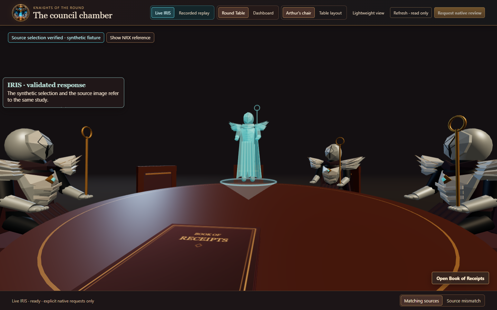

# ⚔️ KnAIghts of The Round

<p align="center">
  <a href="docs/JUDGE-WALKTHROUGH.md"><strong>Judge Walkthrough</strong></a>
  &nbsp;·&nbsp;
  <a href="docs/INTEROPERABILITY.md"><strong>Installation &amp; Interoperability</strong></a>
  &nbsp;·&nbsp;
  <a href="docs/DEMONSTRATION.md"><strong>Demonstration Guide</strong></a>
  &nbsp;·&nbsp;
  <a href="docs/ROADMAP.md"><strong>Roadmap</strong></a>
</p>

<p align="center"></p>

<p align="center"><strong>Governed AI agents. Verifiable decisions. One Round Table.</strong></p>

## What is KnAIghts of The Round?

KnAIghts is an open-source InterSystems IRIS-based platform for coordinating AI-assisted workflows where evidence, authorization, and accountability matter. Agents contribute proposals supported by source references. IRIS validates those proposals, enforces the workflow, and records each disposition.

**The agents contribute intelligence. IRIS remains the authority.**

Built for the **InterSystems AI Agents in Interoperability Workflows contest**, KotR asks a native AI Hub agent to review authorized synthetic evidence and propose an action with citations. An IRIS Interoperability production validates the proposal against its sources, returns a disposition and records an audit. A separate operator approval is required before the synthetic task can be executed.

| Evidence | Governed result |
| --- | --- |
| Matching sources | `ACCEPTED` · `SHOW_VERIFIED` |
| Conflicting sources | `REVIEW_REQUESTED` · `REQUEST_REVIEW` · no verified selection |

**Start here:** follow the [judge walkthrough](docs/JUDGE-WALKTHROUGH.md) to run both cases and inspect the audit. The optional Round Table can present session evidence. Its detailed view uses project-authored procedural knights; a lightweight illustrated view is also available. The core workflow does not require the graphical client or DICOM3D.

<p align="center"></p>

<p align="center"><sub>Actual local application capture with original procedural knights. The displayed matching result is a retained synthetic snapshot served by a mock API; this image does not show fresh IRIS inference.</sub></p>

**Explore without installing:** [Interactive simulation](https://kennethjsmithdev.github.io/KnAIghtsOfTheRound/) · [Media gallery](https://kennethjsmithdev.github.io/KnAIghtsOfTheRound/media/). The simulation replays two synthetic outcomes. The native workflow runs locally in IRIS.

## Features

- Agent-assisted review of authorized evidence.
- Exact citation and source-binding validation before a selection is returned.
- Governed decisions to show verified evidence or request review.
- Typed requests and responses through an InterSystems Interoperability production.
- Auditable dispositions that can be checked against message records.
- An authenticated Codex MCP seat and a native AI Hub agent route.
- ChatGPT/Codex sign-in through the local Codex client, with optional [provider and MCP seat profiles](docs/PROVIDER-SEATS.md) for additional clients and read-only audit/context tools.
- An opt-in [health-source inspection production](docs/HEALTH-SOURCES.md) for synthetic DICOM, DICOMweb, Orthanc, FHIR and HL7v2 evidence, with per-protocol qualification limits.
- Optional [health-source controls](docs/HEALTH-CONTROLS.md) connect the viewer and a separate MCP endpoint to authenticated R4 repository reads, native DICOM C-ECHO observations and HL7 MLLP/ACK receipts. These are locally qualified synthetic profiles; DIMSE query/retrieve and image storage remain planned.
- Operator-approved synthetic task updates with evidence revisions and duplicate-request checks.
- An optional local Workflow worklist and custom notice adapter for synthetic mismatch review.
- An optional Java PEX and IRIS Vector Search profile that supplies advisory related-case context to that worklist, with a separately authenticated [local live-viewer connection](docs/CONTEXT-LIVE.md).
- A lightweight [interactive simulation](demo/README.md) with recorded synthetic outcomes; it does not call IRIS or a model.

## How it works

```text
Authorized evidence → Agent proposal → IRIS validation → Decision + audit record
```

Both demonstration cases use the same `KnAIghtsEntry → AssessEvidence` production route. The agent chooses an action and cites its evidence. IRIS checks the exact ordered references and source agreement, then returns a typed result with an explanation, limitation, and audit ID.

Explore the implementation: [production](src/KnAIghts/Review/Production.cls), [review and validation](src/KnAIghts/Review/Operation.cls), [authorized evidence tool](src/KnAIghts/Review/Tools.cls), and [operator task](src/KnAIghts/Review/SyntheticTask.cls).

Clients can build on this shared review boundary. DICOM3D is the first planned domain adapter. The repository includes the optional dashboard and Round Table. The public IPM package supplies the twelve-class core. Workflow, PEX, and vector profiles have separate local setup, and the complete 58-class integrated distribution remains unbuilt and unqualified. See [local graphical setup](docs/VISUAL_LOCAL.md) and the [local PEX and vector profile](docs/PEX-VECTOR.md).

## Getting started

```powershell
git clone https://github.com/KennethJSmithDev/KnAIghtsOfTheRound.git
cd KnAIghtsOfTheRound
```

The demonstrated runtime is **IRIS for Health AI Hub Community 2026.3.0AI.154.0, Linux x64**, with Docker and Docker Compose. Obtain the Community archive through the [InterSystems Early Access portal](https://evaluation.intersystems.com/Eval/early-access/AIHub). Availability of that exact archive requires confirmation with your portal account.

Load the archive and assign a local alias. Replace the placeholder with the exact image tag or ID printed by `docker image load`.

```powershell
docker image load -i irishealth-community-2026.3.0AI.154.0-docker.tar.gz
docker image tag <loaded-tag-or-sha256-image-id> knaights-iris:build154
$env:KNAIGHTS_IRIS_IMAGE = "knaights-iris:build154"
docker compose build
```

For package-manager installation, see the [IPM guide](docs/INTEROPERABILITY.md#ipm-installation).

Follow the [secure fixture and Codex seat setup](docs/INTEROPERABILITY.md#codex-seat-setup) to start the application with fresh credentials and connect the two synthetic MCP tools. Use your supported ChatGPT sign-in in Codex. The source supplies the application and container configuration. The IRIS image, client access, and model runtime are separately supplied.

For the native agent route, provide the existing local `gpt-oss:20b` model through an authorized OpenAI-compatible endpoint. Copy `.env.example` to `.env`, set `KNAIGHTS_PROVIDER_BASE_URL`, and create `.local` before starting the optional profile.

```powershell
docker compose -f compose.yaml -f compose.live.yaml up --build -d
```

The configured provider must be reachable from the container. The live override enables outbound network routing. Review the [native agent configuration](docs/INTEROPERABILITY.md#optional-native-agent-route) for endpoint admission, resource requirements, and verification.

For a concise demonstration story and evidence distinctions, see [the demonstration guide](docs/DEMONSTRATION.md).

## Example workflow

Follow the [judge walkthrough](docs/JUDGE-WALKTHROUGH.md) for a guided demonstration of native agent decisions, source validation, audit verification, and operator-approved task updates.

Ask the configured Codex seat to review both synthetic cases:

> Review synthetic-a and synthetic-b. For each case, first call ReadSyntheticEvidence. Compare the returned source identities. Choose SHOW_VERIFIED when they agree, or REQUEST_REVIEW when they disagree or remain uncertain. Call SubmitSyntheticDecision with the caseId and a proposal string containing a JSON object with exactly action and citations. Copy evidenceRefs exactly and in order. Report the returned status and audit ID.

| Case | Expected disposition |
|---|---|
| `synthetic-a` | `ACCEPTED` / `SHOW_VERIFIED` |
| `synthetic-b` | `REVIEW_REQUESTED` / `REQUEST_REVIEW` |

The native AI Hub agent reviews the same cases through `KnAIghts.Review.App.Submit()`. See the [native agent example](docs/INTEROPERABILITY.md#optional-native-agent-route) for the complete commands.

Use the [independent verification instructions](docs/INTEROPERABILITY.md#verify-the-demonstration) to compare returned audit IDs and responses against stored dispositions and Interoperability messages.

After a source-conflict review, an operator can propose, inspect, approve, and complete one [synthetic review task](docs/SYNTHETIC-TASK.md). Approval stays tied to the reviewed evidence. A changed evidence revision requires new approval, and a repeated execution request returns the original receipt.

## Current development status

An optional [local seats and accounts workspace](docs/SEATS-LOCAL.md) adds direct ChatGPT sign-in, account and model selection, per-seat permissions, shared-connection scheduling, and source-bound IRIS receipts. It is a separately configured Windows-local profile; it is not part of the existing IPM packages or the static simulation.

**Version 0.1.0 candidate.** Native AI Hub and authenticated Codex MCP workflows have been demonstrated locally on Community Build 154 for the two synthetic cases, with independent audit and message checks. Citation rejection and source-mismatch controls have also been exercised.

The native route currently supports the existing local `gpt-oss:20b` configuration. This entry is qualified on AI Hub Community Build 154. Organizers also accept Build 109, but its application compatibility is unverified. Local IPM installation, restart, uninstall, and same-package reinstall are tested. Public IPM 0.1.0 was independently installed on Build 154 with IPM 0.10.9. Its twelve-class core passed controlled synthetic review, independent native audit/message readback, normal restart and non-destructive uninstall/reinstall. These checks did not invoke a model or qualify the optional integrated package. Detailed scope is recorded in [Interoperability](docs/INTEROPERABILITY.md#qualification-evidence).

This is an early development application for demonstration and testing. Restrict ingress to trusted, configured interfaces. Trusted internal callers can construct principal attribution, and audit records represent individual attempts. The optional local Workflow prototype provides a worklist and notice for synthetic review; production-ready reviewer delivery remains planned.

The synthetic task API has passed sequential state, permission, evidence-change, rollback, and reinstall checks. A bounded two-worker first-execution test returned one execution and one duplicate response with the same receipt; broader load behavior is unqualified. See the [task guide](docs/SYNTHETIC-TASK.md) for its supported scope.

## Technology implementation map

The public IPM 0.1.0 package is the qualified twelve-class core. This repository also includes expanded optional implementations with separately accepted local Build 154 evidence. A complete 58-class integrated IPM distribution is **unfinished and not built**; use the profile-specific source setup below. Raw qualification logs and credentials remain private.

| Technology | Implementation | Reproduce and inspect the recorded scope |
| --- | --- | --- |
| Docker | [Compose](compose.yaml) and [image](Dockerfile) | [Build 154 and secure setup](docs/INTEROPERABILITY.md#codex-seat-setup). Actual IRIS container execution and normal restart were checked. |
| Public IPM core | [Package descriptor](module.xml) and [synthetic checks](scripts/test-synthetic.script) | [Registry installation and lifecycle](docs/INTEROPERABILITY.md#ipm-installation); [qualification summary](docs/INTEROPERABILITY.md#qualification-evidence). |
| Java PEX | [Production host](src/KnAIghts/Context/Production.cls) and [Java operation](pex/java/knaights/pex/RelatedCaseOperation.java) | [Local setup and native combined-flow scope](docs/PEX-VECTOR.md). Java formats advisory context; IRIS checks its result. |
| Workflow Engine | [Review flow](src/KnAIghts/Context/ReviewFlow.cls) and `EnsLib.Workflow.Operation` in the [production](src/KnAIghts/Context/Production.cls) | [Connected viewer demonstration](docs/CONTEXT-LIVE.md#demonstrate-the-combined-path). A real worklist choice remains separate from source acceptance and synthetic-task execution. |
| Custom adapter | [Notice operation](src/KnAIghts/Bonus/NoticeOperation.cls) and [outbound adapter](src/KnAIghts/Bonus/NoticeAdapter.cls) | [Setup and qualification](docs/BONUS-WORKFLOW.md). Persisted task/evidence checks precede the notice; interrupted writes require reconciliation. |
| Embedded Python | [Evidence checksum](src/KnAIghts/Bonus/Fingerprint.cls), called by the notice operation | [Native execution and independently recomputed checksum](docs/BONUS-WORKFLOW.md#qualification-scope). This is an integrity check, not a signature or approval. |
| IRIS Vector Search | [Native query](src/KnAIghts/Context/Vector.cls) and [SQL/HNSW schema](sql/context-index-v1.sql) | [Setup and query-plan scope](docs/PEX-VECTOR.md). Six hand-defined features; no learned-embedding or performance claim. |

These links expose implementations and reproduction instructions, not organizer acceptance of contest bonuses. Optional profile qualification does not establish a fresh integrated-package installation.

## Roadmap

- Reusable workflows and shared session context.
- Broader distribution and qualification of the dashboard, Round Table interface, and Book of Receipts.
- Broader provider, tool-seat and multi-user qualification beyond the optional local seat workspace.
- Domain adapters and source-linked visualization, beginning with DICOM3D.
- Broader qualification and durable delivery for the local human-review prototype.
- Deployment profiles and broader runtime compatibility.

See the [development tracks](docs/ROADMAP.md) for contest delivery and the post-submission interface work. Maintainers can use the [publication checklist](docs/PUBLICATION.md) for Open Exchange and IPM activation.

## Contributing, license, and acknowledgments

Contributions through issues, testing, documentation, and focused changes are welcome. Describe the intended behavior and evidence needed to verify a change.

KnAIghts is licensed under the [Apache License 2.0](LICENSE). The review production pattern is adapted from DICOM3D. Preserve the attribution in [NOTICE](NOTICE). InterSystems IRIS for Health, client software, and model runtimes are separately supplied under their respective terms.
