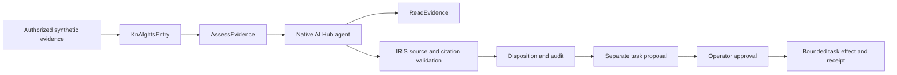

# A three-minute demonstration

An agent recommendation is not an authorization. KnAIghts asks a native AI Hub agent to inspect synthetic evidence, then makes IRIS validate its proposed action and preserve an audit before an operator can approve any task effect.

## What to show

1. Identify the running Build 154 production and configured model. Follow the [judge walkthrough](JUDGE-WALKTHROUGH.md) to submit the matching case. Show `ACCEPTED`, `SHOW_VERIFIED`, the synthetic semantic ID and exact citations.
2. Submit the conflicting-source case. Show `REVIEW_REQUESTED`, `REQUEST_REVIEW` and an empty selection. Read back each actual audit and Interoperability session independently. IDs depend on this installation.
3. Use the review audit to propose a synthetic task. Approval is a separate operator action. After changing the evidence revision, stale approval must fail. Fresh approval permits one task update; repeating the operation returns the original receipt.

The [task guide](SYNTHETIC-TASK.md) explains the revision and duplicate safeguards. No clinical data, diagnosis, patient geometry or DICOM3D installation is required.

## Be precise about the evidence

A retained qualification contains three real outcomes: audit 1 was a provider failure, audit 2 was an accepted decision, and audit 3 was a review decision. They remain immutable evidence of those attempts, not universal IDs to hardcode into a judge's installation. A fresh run must report its own IDs.

A recording or retained result is labeled as such. A LIVE request is described as new inference only when it actually invokes the model. Read-only refreshes are not new agent execution. The optional local Round Table can present retained IRIS evidence, but is not part of this core distribution. Its graphical source and reference assets require separate public admission.

## What this release does not claim

This is a synthetic governance demonstration, not production authorization for arbitrary callers. Core IPM lifecycle and bounded task/concurrency tests are qualified at their stated scope; public registry availability must be checked after maintainer publication. A model provider, supported vendor image and sufficient machine resources are prerequisites. The core package does not include model weights, vendor images, private records, the Round Table or DICOM3D.
